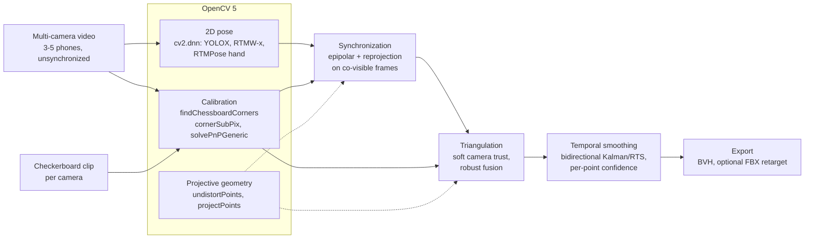
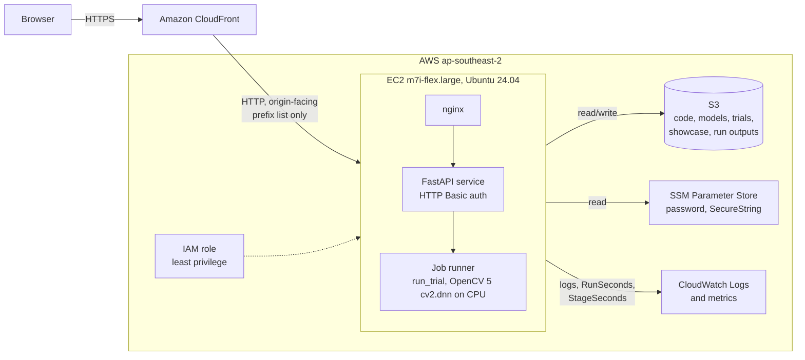

# Architecture

## Pipeline

| stage | module | main OpenCV 5 calls |
|---|---|---|
| calibration | `evaluation/opencap/calibration.py`, `aimocap/calib/` | `findChessboardCorners`, `findChessboardCornersSB`, `cornerSubPix`, `solvePnPGeneric` (IPPE), `Rodrigues`, `projectPoints` |
| person detection and 2D pose | `aimocap/pose/infer.py`, `aimocap/pose/inference_session.py`, `aimocap/pose/part_refine.py` | `dnn.readNetFromONNX`, `Net.forward`, `dnn.NMSBoxes`, `warpAffine`, `VideoCapture` |
| crops for small or portrait subjects | `evaluation/opencap/crops.py` | `VideoCapture`, frame differencing with `morphologyEx` and `connectedComponentsWithStats`, `resize`, `VideoWriter` |
| synchronization | `evaluation/opencap/sync.py` | `undistortPoints` |
| triangulation and smoothing | `aimocap/triangulate/` | `undistortPoints`, `projectPoints`, `Rodrigues` |
| rendering | `evaluation/opencap/render.py`, `aimocap/viz/` | `VideoCapture`, drawing primitives, `resize` |

The inference engine is selected with `--inference-engine {ort,cv2dnn}`. `cv2dnn` runs the
three networks on the OpenCV 5 DNN engine (CPU); `ort` uses ONNX Runtime and is the faster
choice on a CUDA GPU. Both produce the same keypoints to within 0.005 px.

## Cloud deployment

| component | role |
|---|---|
| CloudFront | HTTPS endpoint for judges; caching disabled, all headers except Host forwarded |
| EC2 (m7i-flex.large) | runs nginx, the FastAPI service and the pipeline on CPU |
| S3 | deployment bundle, model weights, prepared trials, precomputed showcase runs, live run outputs (expire after 7 days) |
| SSM Parameter Store | web password as a SecureString, read by the instance at boot |
| SSM Run Command | administration and updates without SSH |
| CloudWatch | service, nginx and bootstrap logs; per-run and per-stage timing metrics |
| IAM | instance role limited to the deployment bucket, one parameter path, one log group and one metric namespace |

The origin security group accepts TCP 80 only from the CloudFront origin-facing prefix
list; there is no SSH port. The instance requires IMDSv2.

## Web service

`service/` exposes the precomputed showcase runs and a live "Quick" preset (three
cameras, body keypoints, two-second window) that runs the full pipeline on the instance
CPU. Each run streams its stage events (`events.jsonl`) to the browser and finishes with
the overlay video, the 3D comparison video, the metrics and the BVH download.
